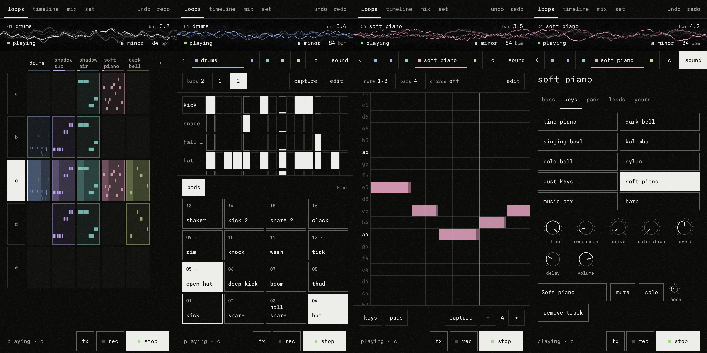
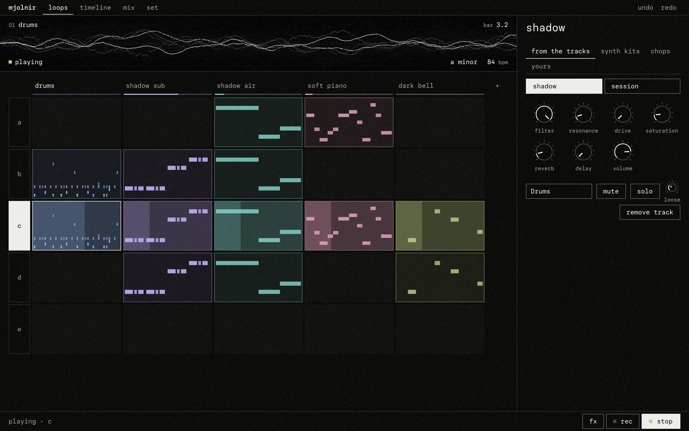

# Mjolnir

An open instrument for sketching beats and finishing them: pads, steps, a piano roll, loops and a timeline, the same on a phone, in a browser and on a desktop. Made for slow, dark, dusty music.





## Get it

| Where | What |
|---|---|
| Any browser | Open the web app and, if you like, install it from the browser's menu. It then works with no network. |
| Linux | An AppImage |
| Windows | An installer, or a portable exe |
| macOS | A disk image for Apple silicon, one for Intel |
| Android | An APK |
| A DAW | A VST 3 instrument for Windows, macOS and Linux: the sounds and the drum loops, played by the DAW |

Every package is built by one script, on one Linux machine: see [INSTALL.md](INSTALL.md) for how to install each and how to build them yourself.

## What it does

- **Loops first.** Tracks across, eight sections down. A click plays a loop, another stops it, a double click steps inside. A letter plays its whole row.
- **Drums**: sixteen pads and sixteen step keys. Every step has a level, a chance of sounding and a number of repeats.
- **Melody**: a piano roll over a keyboard or pads. Chords write and play the chord of the key on any note.
- **Capture**: keep what you just played, even though nothing was recording.
- **Sounds, by kind.** Kits and one-shots cut from lofisons' own tracks; a soft piano, strings, a flute and other real instruments from a public-domain orchestra; a synth with ten engines (strings, wavetable, FM, a plucked and a bowed string, bells, a vowel…) whose every knob is open; and your own: a file or the microphone becomes a sound.
- **A room for the whole mix**: every track sends to one plate reverb and one tape echo. The pump makes room for the kick. Tape, vinyl and warmth on the master.
- **Punch effects**, held with a finger: loop, stutter, tape stop, filters, crush, dub echo, frozen reverb.
- **A song**: one lane per track; click to place a loop, drag to move it. Export the mix, one file per track, MIDI, or a single row as a loop.
- **Sets** kept on the device, saved to files you own, and three demos to listen to.
- English and Spanish. A dark theme and a paper one. MIDI controllers. Keyboard for everything.

The manual is in [guide/GUIDE.md](guide/GUIDE.md).

## With an agent

Mjolnir speaks the Model Context Protocol: an agent can write loops, shape sounds and arrange a song, inside the desktop app while you listen or on its own as a file. See [guide/AGENTS.md](guide/AGENTS.md).

## How it is made

| Path | What |
|---|---|
| `crates/engine` | The audio engine, sequencer and project model. Rust, hand-written DSP, real-time safe, tested. |
| `crates/app` | Every action a person can take, as JSON in and JSON out. One door for every host. |
| `crates/web` | The engine as a WebAssembly module with a plain C interface, for an AudioWorklet. |
| `ui` | The interface (Svelte), drawn with VSGARD. It talks to the engine only through actions. |
| `desktop` | The desktop shell (Electron) around the same web app. |
| `android` | The Android shell (a WebView), built by hand with no Android Studio. |
| `tools` | The scripts that build the sounds, the demos and the icon. |
| `crates/mcp` | `mjolnir-mcp`: the instrument with no window, for an agent (Model Context Protocol over stdio). The tools themselves are in `crates/app/src/mcp.rs`. |
| `crates/plugin` | The sounds as a VST 3 instrument: one track of the engine, played by a host's notes. |
| `site` | The front page of the public site. |
| `docs` | The built site, ready for any static host: the front page, and the web app under `app/`. |

One engine and one interface run everywhere; a host only lends sound out and files. More in [guide/ARCHITECTURE.md](guide/ARCHITECTURE.md).

## Work on it

Needs Rust with the `wasm32-unknown-unknown` target, Node 22 and pnpm.

```sh
rustup target add wasm32-unknown-unknown
pnpm install
pnpm wasm      # the engine, into ui/public/mjolnir.wasm
pnpm dev       # http://localhost:5173
```

```sh
pnpm test      # the engine's tests, the type check, and the app driven in a browser
```

See [CONTRIBUTING.md](CONTRIBUTING.md).

## Where it comes from

The engine began in Yggdrasil; its project files (`.yggdrasil`) still open here. The sounds: [SAMPLES.md](SAMPLES.md). Code: MIT.
