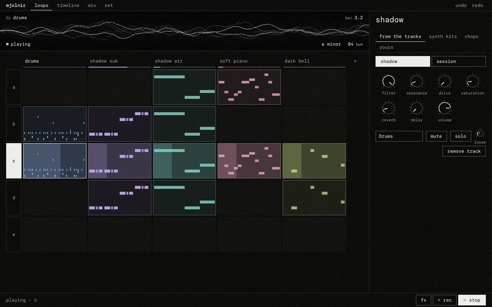
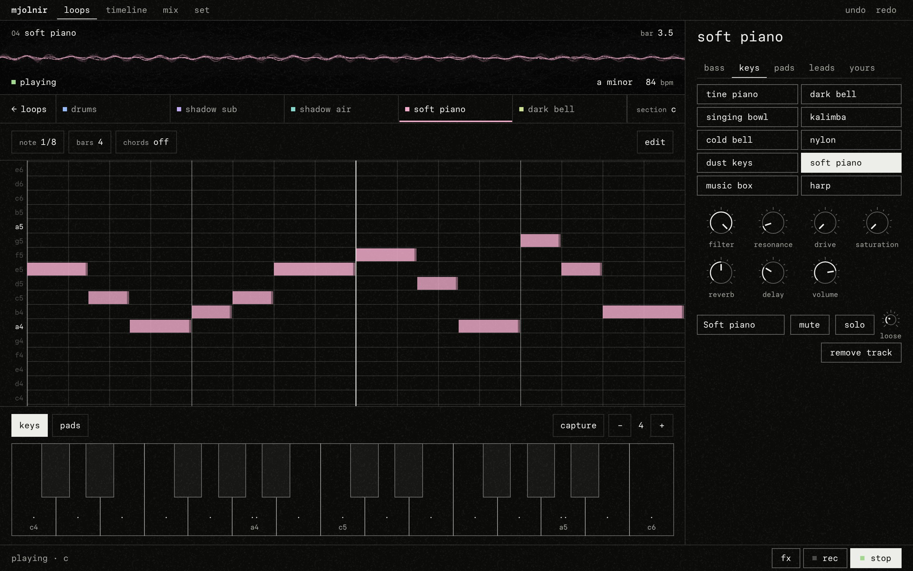
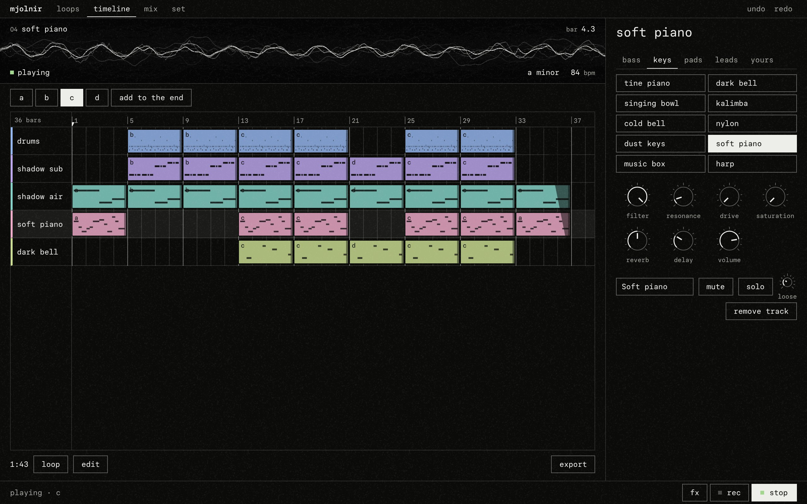
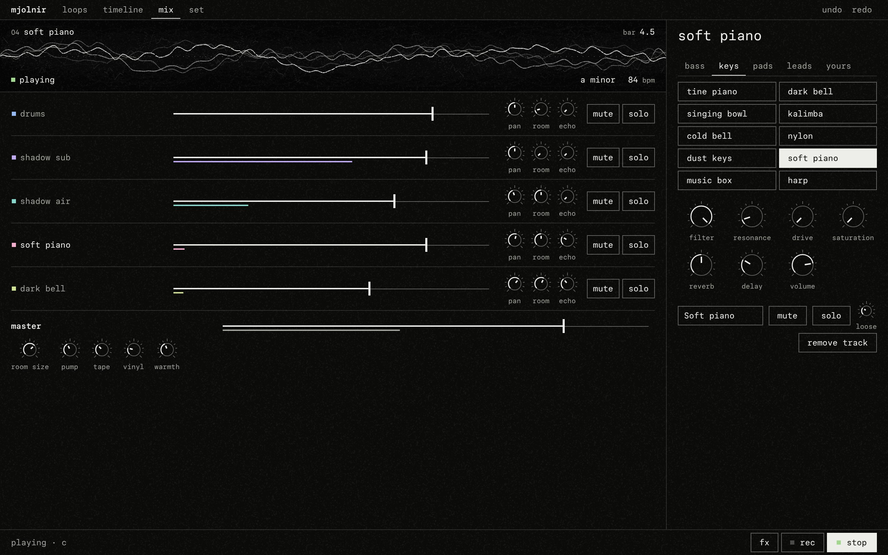

# How to play Mjolnir

Mjolnir has four faces along the top: **loops**, **timeline**, **mix** and **set**. The screen above them draws the sound itself; the line at the foot says what is happening and holds `fx`, `rec` and `play`.

## Loops

The first time, Mjolnir asks one thing: **start a beat** (an empty set, straight into the drums) or **listen first** (the demo, playing).

Tracks run across, sections (a to h) run down. Each cell is a loop, drawn in its track's colour. Only the rows in use are shown, and one empty row under them to grow into.

| Do | To |
|---|---|
| click a loop | play it; click again to stop it at the end of the bar |
| double click a loop | step inside it |
| hold a loop, or right click it | a short menu: open, copy, paste, copy to the next free row, delete loop |
| hold a track's name, or right click it | open, mute, remove track |
| hold a section's letter, or right click it | play the row, rename it, copy it to the next empty row, clear it |
| click `+` beside the tracks | add a track: drums or keys; it opens on its sounds |
| touch the bpm on the screen | change the tempo: −, +, or tap it in |
| touch the key on the screen | choose the root and the scale |
| click `+` | step into an empty loop |
| click a letter | play the whole row |
| click a track's name | step into that track |

A new variation is a copy: hold a section's letter and copy the row down, then change what should change.

## Inside a track

One row at the top: back to the loops, the tracks, the section's letter (touch it for the same track in another section; `loop` marks the ones it already has), and **sound**, which swaps the notes for the track's sound and back.

**Capture** keeps what you just played as the loop, even though nothing was recording. **rec** (at the foot) records what you play from now on, snapped to the grid, with a count-in if you set one.

### A drum track

Each sound has a lane of sixteen steps: touch a step to switch it. The kick, the snare and the hats are there from the start; any pad you play gets a lane of its own. A lane's name plays its sound.

Under the lanes, sixteen pads to play by hand; the higher you touch one, the harder it hits. **pads** folds them away and gives the lanes the room.

Hold a lit step (or right-click it) to see its **level**, its **chance** of sounding on each pass, and how many times it **repeats** inside the step.

`bars` sets the loop's length (making it longer repeats what is there) and which bar is on screen. **edit** holds beats to start from (boom bap, lo-fi lazy, trap half-time, trap bounce, with hats to lay over them) and the loop's copy, paste, snap to the grid and clear.

### A melodic track

The piano roll has the screen. One line of tools sits above it: the note length, the loop's bars, the chords and **edit**; each opens a sheet over the roll, and a touch on the roll behind an open sheet only closes it. Under the roll, **keys** and **pads** fold the playing surface in and out; on a phone it starts folded away.

The piano roll shows only the notes of the key. Click to write a note of the chosen length; drag a note to move it, drag its right edge to stretch it, click it to pick it (its level, chance and repeats appear), double click to remove it. On a touch screen a tap writes; a finger that travels scrolls the sheet and writes nothing.

Under **edit**: **move** carries the whole loop: an octave lower or higher, or one note of the key down or up. **harmony** doubles every note at an interval of the key (a third, a fourth, a fifth, a sixth, an octave), above or below; use it again to stack a chord. Each is one step of undo.

Below it, a keyboard or pads of the key's notes. With **chords** on, every note you write or play is the chord of the key built on it, and the pads show its name.

### Sound

Sounds are filed by kind: bass, keys, pads, leads (kits and chops for drums), and **yours**. Under them, seven knobs: filter, resonance, drive, saturation, how much goes to the room (reverb) and to the echo (delay), and volume. Turn them while recording and the loop remembers the moves.

A synth sound shows every one of its parts below: the engine, three tone knobs whose meaning follows the engine, the envelope, an ensemble and drift.

**Yours**: choose a file or record the microphone (up to twenty seconds). Play it across the keys, as grains, or sliced on the pads.

## Timeline

One lane per track. Choose a section at the top; a click on a lane places that track's loop of it, and `add to the end` puts the whole section after the last bar. Drag a clip to move it, its right edge to change its length, hold ctrl or alt to drag a copy, double click to open the loop. The ruler sets where playback starts. Press play on this face to hear the song. **edit**, at the foot, opens the fades, the zoom and clear.

**Export** bounces the timeline, or just the row on screen as a loop: the mix, one file per track, MIDI. Several files arrive as one zip.

## Mix

Each track: level (with its meter), pan, room, echo, mute, solo. On a phone a strip is its name, its level and its gates; `···` opens its pan, room and echo. The master: level, the size of the room, the pump (how much everything makes room for the kick), tape, vinyl, warmth.

## fx: the punch strip

Eight effects over the whole mix that sound only while held (a finger, or shift with 1 to 8): loop, stutter, tape stop, low pass, high pass, crush, dub echo, frozen reverb.

## Set

Your sets are kept on this device; copy them, remove them, save them to a file or open one. Three demos show what the instrument sounds like. Here too: the set's name, tempo, swing, key (also on the screen, from any face); the metronome, snap and count-in; the theme, the language, and what MIDI controllers are connected.

## Keys

| Key | Does |
|---|---|
| space | play, stop |
| z x c v · a s d f · q w e r · 1 2 3 4 | the sixteen pads |
| a w s e d f t g y h u j k | a piano, in a melodic track |
| shift 1 to 8 | the punch effects |
| esc | back to the loops |
| tab | the next face |
| ctrl z, ctrl shift z | undo, redo |
| delete | remove what is picked |
| ? | help |
